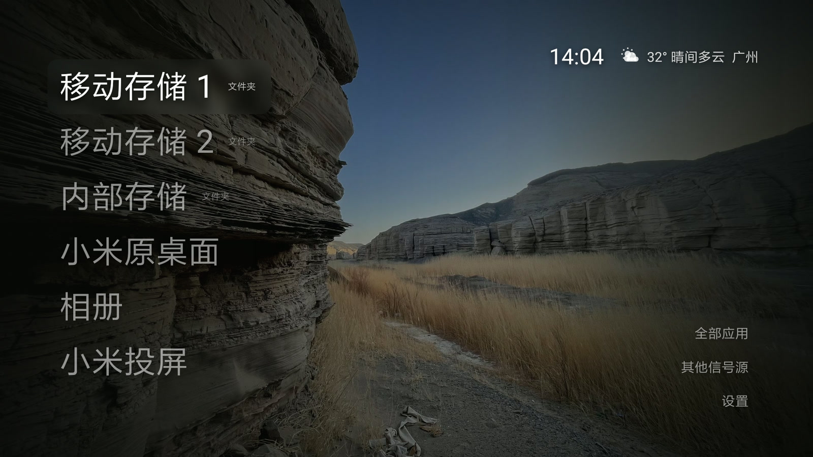

# JK TV

[](https://github.com/Jkcode8/jktv/actions/workflows/android.yml)
[](https://github.com/Jkcode8/jktv/releases/latest)
[](https://github.com/Jkcode8/jktv)
[](LICENSE)

**A launcher that puts the movies and photos on your hard drive on the first screen — one press, it plays.**

A lightweight Android TV launcher for older televisions. It reads external storage directly, generates real thumbnails, and shows weather. No recommendation feed, no boot ads, no account.



**[Download the latest APK](https://github.com/Jkcode8/jktv/releases/latest)**　·　Package `com.jktv.launcher`　·　Android 6.0+ (API 23)

*中文说明见 [README.md](README.md)*

---

## Is this for you?

- **Yes** — your TV is a 2016–2020 model stuck on Android 6–9, the stock launcher is full of recommendations and boot ads, and your media lives on a portable drive or NAS that takes four menu presses to reach.
- **Also yes** — you just want a clean home screen and will install the APK. Or you want a sub-5k-line Android TV codebase running on an old API level as a starting point.
- **No** — you want to search shows, stream, or watch live TV. This is a launcher and file browser. It ships no content source and integrates with no streaming service.

## What this fork changes

This is a fork of [**guizang-tv**](https://github.com/op7418/guizang-tv) by [@op7418](https://github.com/op7418), starting at upstream `main` @ `312c011`. The visual language — list and Dock layout, focus styling, frosted materials, grouped settings, the AI chat overlay — all comes from upstream. What this fork does is make it install and actually work as a file browser on a 2016 device.

| | Upstream | This fork |
| --- | --- | --- |
| Min SDK | 26 (Android 8) | **23 (Android 6)**, with Java 8 API desugaring |
| Home entries | App shortcuts | Adds **folder entries** bound to a storage path — press OK, you land in that directory |
| Folder browsing | — | `FolderActivity`: 4-column 16:9 grid, cover generation with on-disk cache |
| Image viewer | — | `ImageViewerActivity`: full screen, left/right paging, `2 / 5` counter |
| Audio | Handed to the video player, black screen | `AudioPlayerActivity`: filename, progress bar, duration, prev/next |
| Video playback | Generic `ACTION_VIEW` | Xiaomi private `PLAY_URL` + `playInfo`, pinned to the system player |
| Weather | Current conditions | Adds daily high/low and a 3-day forecast; TLS fallback for old root CAs |
| Wallpapers | 5 bundled, rotation | 12 bundled (5 Unsplash + 7 by the maintainer), plus local photo import with EXIF stripping |
| Boot start | — | `start_3rd_app` system setting + a minimal decision activity |

The full story of the Android 6 compatibility work — stale root certificate store breaking TLS, `NoSuchMethodError` on `Map.putIfAbsent`, `error_code (1001,1)` from `ACTION_VIEW` — is in the [Chinese README](README.md#为了跑在-android-6-上踩过的坑).

## Features

- **Straight to the folder.** Home entries are real paths on a storage volume, not shortcuts. Press OK and you are in a thumbnail wall.
- **Every tile has a real cover.** Folder covers come from the first photo, or a frame grabbed at 1/5 of the first video's duration. Missing at this level? It searches two levels down. Results are cached.
- **Photos up to full screen**, with EXIF orientation corrected so portrait shots do not lie down.
- **Audio gets a screen.** Filename, state, progress, `0:06 / 0:55`, track index. OK toggles, ←/→ seek 10s, ↑/↓ change track, auto-advance at the end.
- **Weather and clock** in the top right, from [Open-Meteo](https://open-meteo.com/). City auto-detected or set manually.
- **Seven settings groups on one page**, with a live home preview on the right.
- **Readable text on bright wallpapers.** The left gradient deepens based on the wallpaper's average luminance.

## Build

JDK 17, Android SDK 34, Gradle wrapper 8.9 included.

```bash
git clone https://github.com/Jkcode8/jktv.git
cd jktv
./gradlew :app:assembleDebug      # Windows: gradlew.bat :app:assembleDebug
```

Output: `app/build/outputs/apk/debug/app-debug.apk`.

For a release build you must configure signing first (see [Chinese README](README.md#关于包名与签名)), otherwise the APK is unsigned and will not install.

> First build downloads Gradle 8.9 (~130 MB). If that stalls on a slow connection, swap `distributionUrl` in `gradle/wrapper/gradle-wrapper.properties` for a mirror.

## Install

Side-load it. Copy the APK to a USB stick and open it from the TV's file manager, or use adb:

```bash
adb connect <tv-ip>:5555
adb install -r JKTV-0.4.2.apk

# Boot start (MIUI TV): write the package name into a system setting
adb shell settings put system start_3rd_app com.jktv.launcher
```

ADB is off by default and every vendor hides the switch somewhere else. The [Chinese README](README.md#先在电视上打开-adb-调试) walks through Xiaomi/Redmi, stock Android TV, and the Android 11+ pairing flow.

The app does not replace any system component. Turn off "Home & startup" in settings, or just uninstall it, and the stock launcher comes back.

## No dev environment? Three paths

1. **Install the release APK** from [Releases](https://github.com/Jkcode8/jktv/releases/latest).
2. **Let an AI edit it, let Actions compile it.** Fork the repo, edit in the GitHub web editor, and the bundled workflow builds it. Grab `jktv-debug` from the run's Artifacts panel.
3. **Just swap wallpapers.** No code: put photos on a USB stick and pick them in settings.

## Known limitations

| Limitation | Cause |
| --- | --- |
| ADB resets after reboot | MIUI TV behaviour; remote maintenance only |
| Video playback cannot be screenshotted | Hardware decoding outputs to a separate layer |
| One storage volume per entry | Each entry binds a specific volume; swapping drives means re-picking the folder. First-run entries are discovered at runtime, never hard-coded |
| Verified on one device only | MiTV4-ANSM0 / Android 6.0.1. Video launch on other brands needs a separate branch |

## Roadmap

See [接下来想做什么](README.md#接下来想做什么). In short: voice chat with local memory, multi-volume entries, non-Xiaomi device support, `strings.xml` extraction.

## Wallpapers and licensing

Twelve bundled wallpapers, two licences:

| Source | Count | Licence |
| --- | --- | --- |
| Bundled upstream | 5 | [Unsplash License](https://unsplash.com/license) |
| Shot by the maintainer | 7 | [CC0 1.0](https://creativecommons.org/publicdomain/zero/1.0/) — public domain, no attribution required |

Both sets are free to use, redistribute, and use commercially. Code is MIT; images are not covered by it. Details in [`docs/WALLPAPERS.md`](docs/WALLPAPERS.md).

## Credits

- [@op7418](https://github.com/op7418) — [guizang-tv](https://github.com/op7418/guizang-tv), the base
- [Gathin23](https://github.com/Gathin23) — [cleanyourtv](https://github.com/Gathin23/cleanyourtv)
- [Nathan Clark](https://github.com/nthnclrk) — [CleanFrame](https://github.com/nthnclrk/CleanFrame), settings interaction reference
- [Open-Meteo](https://open-meteo.com/) — free weather and geocoding, data under CC BY 4.0
- [Unsplash](https://unsplash.com/) — bundled wallpapers

## License

MIT, inherited from upstream. See [`LICENSE`](LICENSE). Third-party assets keep their own licences.
