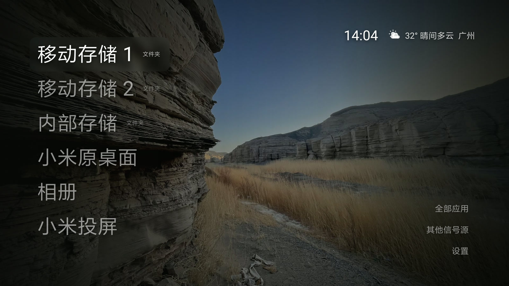
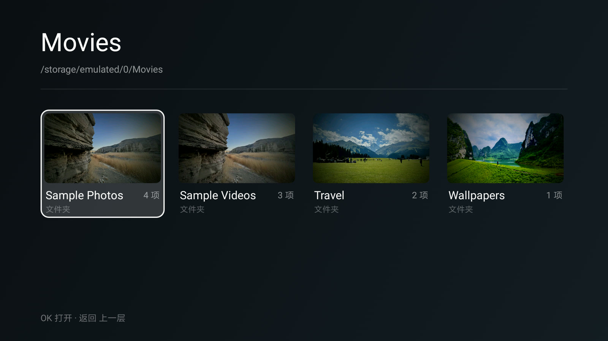
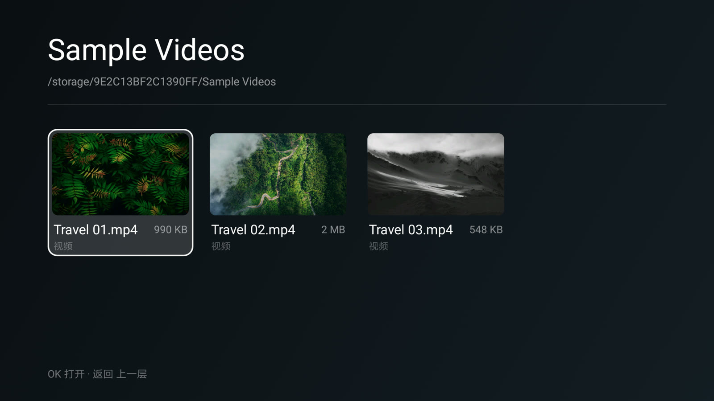
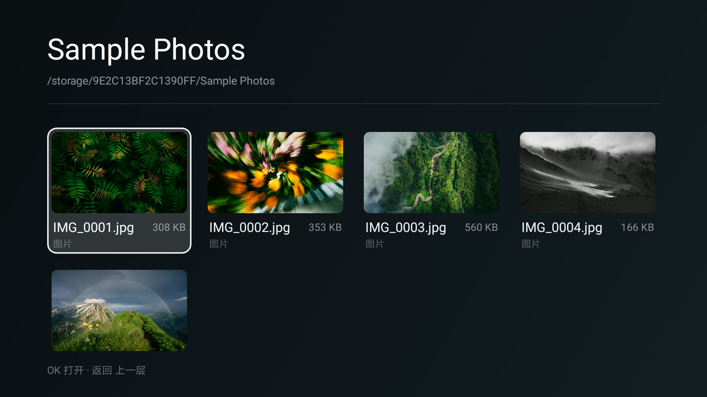
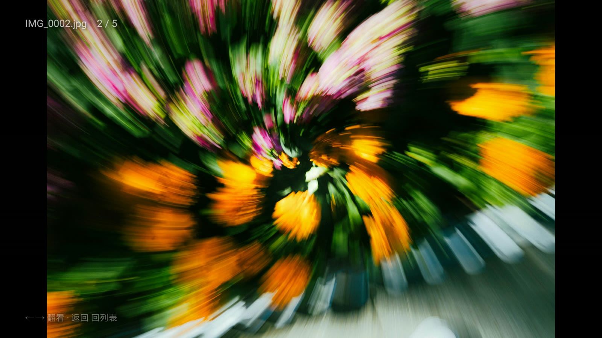
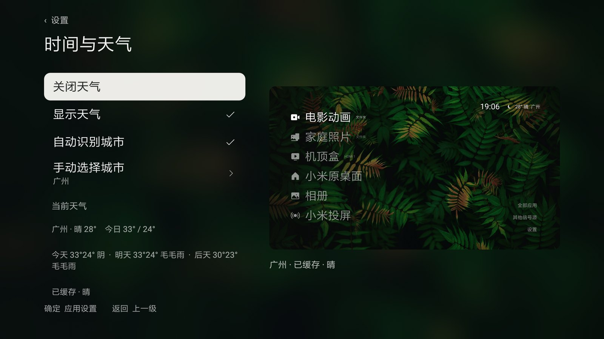
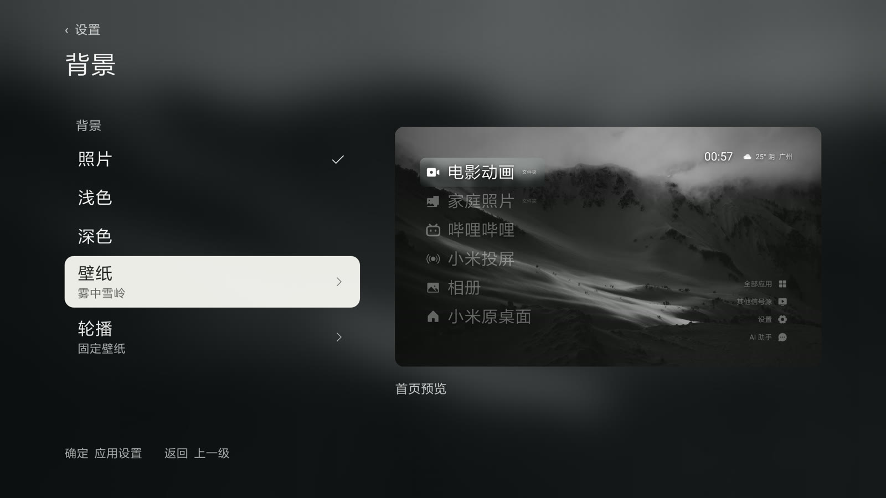
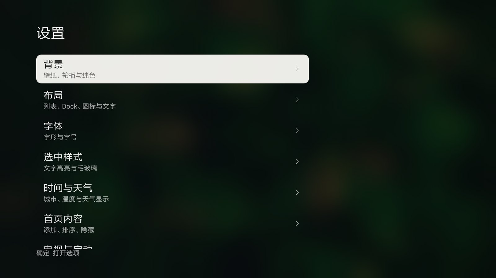

# JK TV

**把硬盘里的片子与照片，放到开机第一屏；一次点击，直接开播。**

一个可以在老款 Android TV 上自建桌面、直读外接硬盘的轻量 Launcher。没有推荐位、没有开机广告、没有账号，只有你自己的入口、真实缩略图和天气。



**[下载 v0.4.1 APK](https://github.com/Jkcode8/jktv/releases/latest)**　·　包名 `com.jktv.launcher`　·　最低 Android 6.0（API 23）

> 仓库：<https://github.com/Jkcode8/jktv>　·　`git clone https://github.com/Jkcode8/jktv.git`

---

## 这个版本从哪来

本项目是 [**guizang-tv**](https://github.com/op7418/guizang-tv) 的二次开发版本。

- 上游作者：[@op7418（归藏）](https://github.com/op7418)
- 上游仓库：<https://github.com/op7418/guizang-tv>
- 本分支起点：上游 `main` @ `312c011`

上游项目本身也站在别人的肩膀上——它衍生自 [Gathin23/cleanyourtv](https://github.com/Gathin23/cleanyourtv)（MIT），并参考了 [nthnclrk/CleanFrame](https://github.com/nthnclrk/CleanFrame) 的设置交互。完整的来源链条、第三方素材与许可说明，请见上游仓库的 [`NOTICE.md`](https://github.com/op7418/guizang-tv/blob/main/NOTICE.md)。

**首页的整体设计语言、列表与 Dock 布局、选中样式与磨砂材质、设置分组与首页预览、AI 助手浮层的视觉，都来自上游。** 本版本没有重新设计界面，做的是另一件事：让它在 2016 年的机器上装得上、跑得动，并且真的能当文件浏览器用。

---

## 上游 vs 本版本

| 能力 | 上游 guizang-tv | 本版本 |
| --- | --- | --- |
| 最低系统 | `minSdk 26`（Android 8） | `minSdk 23`（Android 6），含 Java 8 API desugaring |
| 首页入口 | 应用快捷方式 | 增加「文件夹」类型入口，可绑定存储卷路径，按下确认直接落到该目录 |
| 目录浏览 | — | 新增 `FolderActivity`：4 列 16:9 网格、封面生成与落盘缓存 |
| 图片查看 | — | 新增 `ImageViewerActivity`：全屏、左右翻页、序号显示 |
| 音频 | 交给视频播放器，画面全黑 | 新增 `AudioPlayerActivity`：文件名、进度条、时长、上下首 |
| 视频播放 | 通用 `ACTION_VIEW` | 小米私有 `PLAY_URL` + `playInfo`，固定调用系统播放器 |
| 天气 | 实时天气 | 增加今日高低温与未来三天预报；TLS 兼容性重试 |
| 壁纸 | 内置 5 张 + 轮播 | 内置 12 张（5 张 Unsplash + 7 张作者自拍）；支持导入本地照片：转 16:9、按 EXIF 摆正、剥离定位信息 |
| 亮色壁纸可读性 | 白字直接压在图上 | 左侧渐变随亮度加深，文字加投影 |
| 开机自启 | — | `start_3rd_app` + 极轻量启动判断 Activity |
| 应用名 | 归藏电视 | JK TV（包名 `com.jktv.launcher`，可与上游版本共存安装） |

---

## 功能

### 硬盘直达，跳过三层菜单

首页的「电影动画」「家庭照片」不是快捷方式，而是绑定到具体存储卷的路径。按下确认键，直接落到那个目录的缩略图墙，中间不经过任何系统菜单。



### 每一格都有真实封面

- 文件夹优先取内部第一张照片作封面；没有照片时，取第一个视频的抽帧（按时长 1/5 处取，避开片头黑场）
- 当前层找不到就向下找两层，深层目录也能出图
- 照片按 EXIF 方向自动摆正，竖拍不会躺倒
- 封面结果落盘缓存，第二次进入直接出图
- 视频同样出缩略图并标注文件大小



### 照片：从缩略图墙到全屏



全屏查看时，左上角显示文件名与 `2 / 5`，左右翻页，在当前目录内循环。



### 声音也要有界面

音频如果交给视频播放器，结果是**只有声音、画面全黑**——那本来就是个视频播放器。所以单独做了一个音频页面：文件名、播放状态、进度条、`0:06 / 0:55`、曲目序号，全部可见。

| 按键 | 行为 |
| --- | --- |
| 确认 | 播放 / 暂停 |
| ← → | 快退 / 快进 10 秒 |
| ↑ ↓ | 上一首 / 下一首（循环） |
| 播完 | 自动接下一首 |

### 天气与时间

右上角一行显示时间、天气图标、温度、天气状况、城市名。数据来自 [Open-Meteo](https://open-meteo.com/)，城市可自动识别或手动指定，另含今日最高／最低温与未来三天预报。



### 背景与设置

七组设置全部在同一页面完成，右侧是「首页预览」，改动实时反映，不用反复退回首页确认。





---

## 为了跑在 Android 6 上，踩过的坑

这台测试机是 2016 年的小米电视（MiTV4，Android 6.0.1 / API 23），而上游最低要求 API 26。真正的工作量不在界面，在兼容层。

**1 · 系统根证书库太旧，天气一直拿不到数据**

现象是天气开关打开了、缓存文件却始终是空的。`api.open-meteo.com` 用 Let's Encrypt，`ipwho.is` 用 Google Trust Services——两张根证书都不在 2015 年的系统证书库里，TLS 握手在请求发出之前就失败了，抛的是 `SSLException`，不是网络错误。

解法：首次请求失败时捕获 `SSLException`，用受限的宽松校验重试一次；同时把超时从 8 秒放宽到 12 秒（实测响应约 3.2 秒）。

**2 · Java 8 默认方法在 API 23 上不存在**

改字节码把 dex 版本从 038 降到 035 只能解决「装不上」。装上之后 `Map.putIfAbsent` 立刻 `NoSuchMethodError`。最终放弃二进制改造，改为开启 `coreLibraryDesugaring` 重新编译，共处理 4 处调用。

**3 · 视频播放不能走通用入口**

直接拼 `ACTION_VIEW + file://` 在这台电视上会报 `error_code (1001,1)`。改用小米的私有接口 `tv.intent.action.external.PLAY_URL`，以 JSON 传 `playInfo`，播放器正常拉起，倍速与字幕都可用；同时固定指向 `com.mitv.videoplayer`，不再每次弹「用哪个应用打开」。

**4 · 视频播放中的画面截不出来**

硬件解码输出到独立图层，系统截图和录屏只能拿到黑帧。所以本文里所有视频相关截图，展示的都是文件列表与封面，而不是播放中的画面——这是硬解的正常表现，不影响实际观看。

---

## 构建

环境：JDK 17、Android SDK 34（build-tools 34）。Gradle 由仓库自带的 wrapper 提供（8.9），不需要单独安装。

```bash
git clone https://github.com/Jkcode8/jktv.git
cd jktv
./gradlew :app:assembleDebug      # Windows: gradlew.bat :app:assembleDebug
```

产物在 `app/build/outputs/apk/debug/app-debug.apk`。

打正式包用 `./gradlew :app:assembleRelease`，但必须先配好签名环境变量（见文末「关于包名与签名」），否则产出的是未签名 APK，装不上。

> 首次构建会下载 Gradle 8.9（约 130 MB）和全部依赖。国内网络如果卡在 Gradle 下载这一步，把 `gradle/wrapper/gradle-wrapper.properties` 里的 `distributionUrl` 换成 `https\://mirrors.cloud.tencent.com/gradle/gradle-8.9-bin.zip` 即可。
>
> `settings.gradle` 里已经预置了阿里云 Maven 镜像，专门为了国内网络拉依赖。不需要的话删掉那几行 `maven { url 'https://maven.aliyun.com/...' }`。

---

## 不想装开发环境？三条不用敲命令的路

上面一节是给会写代码的人看的。如果你只是想把界面改成自己喜欢的样子，下面三条路都不需要在本机装 JDK 和 Android SDK。

**1 · 直接装现成的**

从 [Releases](https://github.com/Jkcode8/jktv/releases/latest) 下载 APK，拷进 U 盘插到电视上装。多数人的需求到这一步就够了。

**2 · 让 AI 帮你改，让 GitHub 帮你编译**

把仓库链接丢给任意一个能读代码的智能体——Claude、ChatGPT、Codex、Cursor、WorkBuddy 都行——说清楚你要什么，它会告诉你改哪几个文件、改成什么样。改完出 APK 有两条路：

- **手上没有编译环境**：在 GitHub 上 Fork 这个仓库，用网页编辑器直接提交改动，仓库自带的 Actions 会自动编译。到 `Actions` → 最新一次运行 → 页面底部的 `Artifacts` 下载 `jktv-debug`，解压出来就是能装的 APK。debug 版功能完整，只是签名与正式包不同，不能覆盖升级正式包。
- **有电脑**：按上一节的命令跑 `./gradlew :app:assembleDebug`。

可以直接拿这段话开头：

```text
仓库：https://github.com/Jkcode8/jktv
这是一个跑在 Android TV 上的桌面启动器（Java，minSdk 23，compileSdk 34）。
我的电视是「＜品牌 型号＞」，系统是 Android ＜版本＞。
我想＜把首页的「电影动画」入口默认指向 /storage/xxxx 这个目录 / 把天气城市固定为广州 / 把选中态的高亮色改成暖橙＞。
请先说明需要改哪几个文件、每个文件改什么，再给完整代码；
最后告诉我怎么构建，或者怎么直接在 GitHub 网页上把这些改动提交上去。
```

几句提醒：

- AI 给的第一版经常「看起来对」。装到电视上试一次再定，别直接发给别人。
- 让它改 `assets/wallpapers/catalog.json` 时注意上限是 15 条，超了整个索引会失效，应用退回渐变背景。
- 不要用 AI 随手生成的密钥去发布 APK。签名一旦换掉，老用户只能卸载重装，壁纸和入口配置都会丢（见文末「关于包名与签名」）。
- 顺手让它把 `applicationId` 也改掉，就能和官方包装在同一台电视上对比着看。

**3 · 只想换壁纸**

不用碰代码：把照片放 U 盘插到电视上，在设置里选。想打进安装包，按 [`docs/WALLPAPERS.md`](docs/WALLPAPERS.md) 的两套流程走——自己用的放 `local/`，可公开的放 `author/`。

---

## 安装到电视

装包有两条路：U 盘最省事，ADB 方便远程维护和批量部署。

### 用 U 盘装（不需要开 ADB）

从 [Releases](https://github.com/Jkcode8/jktv/releases) 下载 `JKTV-0.4.1.apk`，拷到 U 盘，插到电视上，用电视自带的「文件管理」或「媒体中心」找到这个文件，点开安装。第一次会提示「禁止安装未知来源的应用」，在弹窗里允许即可。

### 先在电视上打开 ADB 调试

想用 `adb install` 装包或做远程维护，得先把调试通道打开。ADB 默认是关的，而且各家入口位置不一样。

**小米／红米电视（MIUI TV）**

1. 遥控器按「设置」→「账号与安全」。
2. 找到「ADB 调试」，设为**允许**。
3. 同一页上的「安装未知来源的应用」一并允许。
4. 回「设置」→「关于」→「网络信息」，记下电视 IP（形如 `192.168.10.14`）。

有的 MIUI 版本把这一项放在「设置 → 系统 → 开发者选项」。如果两处都找不到，去「关于」里对「产品型号」连按五次确认键，开发者选项就会出现在设置菜单里。

**原生 Android TV／其他品牌**

「设置」→「关于」→ 对「版本号」连按七次 → 返回上一级出现「开发者选项」→ 打开「USB 调试」，同时打开「网络调试」或「ADB over network」。

**Android 11 及以上**

无线调试改成了配对制：「开发者选项」→「无线调试」→「使用配对码配对设备」，电脑端先 `adb pair ＜IP＞:＜配对端口＞` 输入电视上显示的六位码，再 `adb connect ＜IP＞:5555`。这两个端口不是同一个，别混用。

**连上电视**

```bash
adb connect 192.168.10.14:5555   # 电视和电脑要在同一个局域网
adb devices                       # 列表里出现 IP:5555 才算成功
adb install -r JKTV-0.4.1.apk

# 开机自启：把包名写入系统设置项
adb shell settings put system start_3rd_app com.jktv.launcher
```

第一次 `connect` 时电视上会弹「是否允许 USB 调试」，用遥控器选「一律允许」。没弹窗就 `adb kill-server` 重来一次。

| 现象 | 原因与处理 |
| --- | --- |
| `connection refused` | 电视上的 ADB 开关没开，或者电视进了休眠。唤醒后重试 |
| 一直 `offline` / `unable to connect` | 不在同一网段，或路由器开了 AP 隔离。换手机热点试一次即可判断 |
| 重启后又要重开 | MIUI TV 的既有行为，ADB 开关与 `start_3rd_app` 都会复位 |
| `INSTALL_FAILED_UPDATE_INCOMPATIBLE` | 电视上已有一个同名但签名不同的应用，先卸载再装 |
| 装完闪退 | 系统低于 Android 6.0，或签名/架构不匹配。本项目出的是 arm64-v8a 与 armeabi-v7a 通用包 |

### 装好之后

按遥控器首页键回到 JK TV；想退回小米原桌面，在设置里关掉「桌面与启动」，或者直接卸载——应用没有替换任何系统组件，卸掉就恢复原样。

也可以自己构建，release 产物在 `app/build/outputs/apk/release/app-release.apk`（需要配置签名，见文末）。

---

## 已知限制

| 限制 | 原因 |
| --- | --- |
| 电视重启后 ADB 会复位 | MIUI TV 的既有行为，需要在开发者选项里重新打开网络调试。只影响远程维护 |
| AI 助手入口未接通 | 界面与入口来自上游，后端需要在电脑侧运行本地服务并完成一次授权。当前版本点击该入口不产生动作 |
| 视频播放画面无法截图 | 硬解输出在独立图层 |
| 只适配单卷路径 | 两个直达入口绑定具体存储卷 ID，换硬盘后需要在设置里重新指定目录 |
| 仅在一台机型上验证 | MiTV4-ANSM0 / Android 6.0.1。其他机型（尤其非小米）的视频拉起逻辑需要另做适配 |

---

## 壁纸素材与许可

界面和交互来自归藏老师的上游版本，内置壁纸则分两批，许可各自独立：

| 来源 | 数量 | 许可 | 说明 |
| --- | --- | --- | --- |
| 上游版本自带 | 5 张 | [Unsplash License](https://unsplash.com/license) | 由上游选定，逐张核对了原页面的作者与授权标记 |
| 我自己拍的 | 7 张 | [CC0 1.0](https://creativecommons.org/publicdomain/zero/1.0/deed.zh) | 雅丹、草原、梯田、山水，v0.4.1 起加入 |

两批都**可以免费使用**——当壁纸、二次分发、商用都行。区别只在署名：Unsplash 那批按 Unsplash License 走（未做显著修改的照片不得单独出售，建议保留作者署名）；我拍的这批是 CC0，已释出到公有领域，**连署名都不要求**，拿走直接用。

要再分发的话，这段写不写都行，写了更厚道：

> 壁纸来自 JK TV（<https://github.com/Jkcode8/jktv>）：5 张适用 Unsplash License，7 张由 Jkcode8 以 CC0 1.0 释出。

七张自拍做过统一处理：16:9 裁到 1920 × 1080、亮度 −0.09 EV、降饱和，再按原图平均亮度叠一层自适应暗角，输出时剥离 EXIF——拍摄定位、机型、时间都不会跟着图片跑出去。这批照片里没有人物肖像。逐张清单、处理参数与重新生成的命令见 [`docs/WALLPAPERS.md`](docs/WALLPAPERS.md)。

代码是 MIT，图片不是：这两套许可互不覆盖，也都不因仓库的 MIT 声明而改变。

---

## 关于包名与签名

本版本的 `applicationId` 是 `com.jktv.launcher`，与上游的 `io.github.op7418.guizangtv` 完全独立，两者可以同时装在一台电视上互不影响。

如果你要发布自己的 APK，建议再改一次包名（换成你自己的域名反写），并在 `app/build.gradle` 里配置签名：

```bash
export JKTV_KEYSTORE=/path/to/release.jks
export JKTV_STORE_PASSWORD=******
export JKTV_KEY_ALIAS=jktv
export JKTV_KEY_PASSWORD=******
```

不配置这组环境变量时，构建产出未签名 APK，只能自己调试用。密钥与密码不要提交到 Git。

**关于已发布的 APK**：Releases 里的包用项目自签证书（`CN=JK TV`，RSA 4096，30 年有效期）签名，同时带 v1（JAR）与 v2 签名方案——Android 6 只认 v1，缺了就装不上。

如果你要长期维护这个应用，务必在首次发布后把 keystore 备份好：Android 只允许同一签名的 APK 覆盖升级，换证书就只能卸载重装，用户数据（壁纸、入口配置）会丢。自己 fork 重新发版的话，请生成自己的 keystore，不要沿用这里的包名和签名。

---

## 截图说明

文中的照片、视频均为演示素材：照片取自项目内置的五张 Unsplash 壁纸（Unsplash License），视频是这些图片生成的短暂推拉镜头，不含第三方影视内容与任何真人肖像。

v0.4.1 的安装包里还多了 7 张我自己拍的照片（CC0 1.0，无署名要求）。本文截图是在加入这批照片之前拍的，所以图里看到的是 Unsplash 那几张。

---

## 致谢

- [@op7418](https://github.com/op7418) — [guizang-tv](https://github.com/op7418/guizang-tv)，本项目的基础
- [Gathin23](https://github.com/Gathin23) — [cleanyourtv](https://github.com/Gathin23/cleanyourtv)，上游的上游
- [Nathan Clark](https://github.com/nthnclrk) — [CleanFrame](https://github.com/nthnclrk/CleanFrame)，设置交互参考
- [Open-Meteo](https://open-meteo.com/) — 免费天气与地理编码，数据 CC BY 4.0
- [Unsplash](https://unsplash.com/) — 内置壁纸，Unsplash License

## License

代码沿用上游的 MIT License，见 [`LICENSE`](LICENSE)。第三方素材（壁纸、图标、天气数据）各自适用其原始许可，不因本仓库的 MIT 声明而改变。
