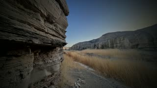
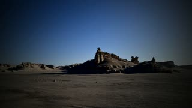
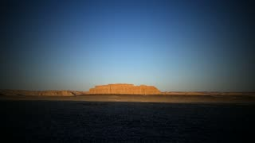
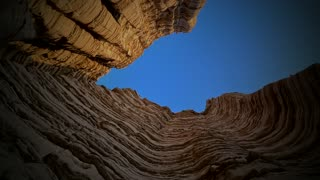
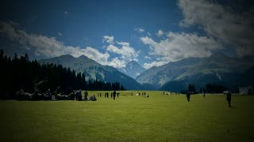
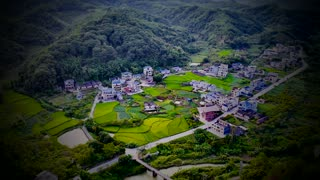
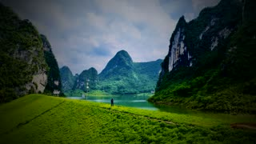

# 内置壁纸与许可

内置 12 张壁纸，分两批，许可各自独立：

- **5 张 Unsplash 照片**——2026-10-20 截图中选定的那五张，逐张原页面已核对作者与「Free to use under the Unsplash License」标记；没有包含其余 Wallhaven 图片。
- **7 张维护者自拍**——v0.4.1 起加入，CC0 1.0，详见文末。

两批都可以免费使用，区别在署名：Unsplash 那批按 Unsplash License，作者照片那批已释出到公有领域，连署名都不需要。

图片遵循 [Unsplash License](https://unsplash.com/license)，不属于项目代码的 MIT 授权。可免费复制、修改及分发用于本桌面；不得将未作显著修改的照片单独出售，或汇编成与 Unsplash 相似或竞争的服务。

| 预览 | 桌面名称 | 摄影师 | 原始页面 |
| --- | --- | --- | --- |
|  | 雾中雪岭 | [Arina Avdzhian](https://unsplash.com/@yallwacky) | [Unsplash](https://unsplash.com/photos/a-black-and-white-photo-of-a-snow-covered-mountain-rSYsP5TlEAk) |
|  | 雨林山路 | [Geio Tischler](https://unsplash.com/@oww) | [Unsplash](https://unsplash.com/photos/a-winding-road-in-the-middle-of-a-forest-hqzyUL3M21k) |
|  | 热带绿叶 | [Łukasz Rawa](https://unsplash.com/@lukasz_rawa) | [Unsplash](https://unsplash.com/photos/green-leaves-and-foliage-create-a-dark-and-lush-scene-4axNezh03UA) |
|  | 山间彩虹 | [Pascal Debrunner](https://unsplash.com/@debrupas) | [Unsplash](https://unsplash.com/photos/a-rainbow-arches-over-a-majestic-mountain-landscape-vwFvhJf6u_I) |
|  | 流光花影 | [Patrick Shaun](https://unsplash.com/@xiexianghua) | [Unsplash](https://unsplash.com/photos/a-blurry-photo-of-a-bunch-of-flowers-JtF_FvXVQQI) |

五张原图合计 18,776,212 bytes；显示副本与缩略图共 1,923,618 bytes，缩减 89.8%。

处理：显示副本最长边 1920 像素、JPEG quality 85；缩略图 320 × 180、quality 78；启用 optimize/progressive。原图不变，副本不写入 EXIF 或 GPS 信息。默认每 5 分钟顺序轮播，固定选择功能不变。

作者与来源也记录在 APK 内的 `assets/wallpapers/catalog.json`；资源大小、尺寸及校验值见 [媒体索引](../app/src/main/assets/wallpapers/bundled/MEDIA-INDEX.md)。

## 维护者拍摄的照片（CC0 1.0）

从 v0.4.1 起，另外随包 7 张维护者本人拍摄的风景照，与上面 5 张 Unsplash 照片一起轮播，并排在壁纸列表最前面。这批照片没有人物肖像，也不含可识别的地点或个人标识。

摄影：[Jkcode8](https://github.com/Jkcode8)，以 [CC0 1.0](https://creativecommons.org/publicdomain/zero/1.0/deed.zh) 释出到公有领域——可以复制、修改、商用、再分发，**不需要署名**，也不需要标注来源。这一批**不适用** Unsplash License，同样不因放入本仓库而转为 MIT（CC0 已放弃权利，MIT 无从叠加）。

| 预览 | 桌面名称 | 文件 |
| --- | --- | --- |
|  | 雅丹层岩 | `author/author-01.jpg` |
|  | 戈壁孤峰 | `author/author-02.jpg` |
|  | 夕照台地 | `author/author-03.jpg` |
|  | 岩壁天光 | `author/author-04.jpg` |
|  | 草原与雪岭 | `author/author-05.jpg` |
|  | 梯田村落 | `author/author-06.jpg` |
|  | 山水之间 | `author/author-07.jpg` |

处理：16:9 中心裁切到 1920 × 1080，亮度 −0.09 EV、饱和度 0.92，再按原图平均亮度加一层自适应暗角（`vignette=angle=PI/3.0`～`PI/4.0`，越亮的图压得越深），保证左侧文字压上去仍然清楚。输出经 `-map_metadata -1` 剥离 EXIF，拍摄定位、机型、时间都不会进安装包。缩略图 320 × 180。七张合计约 2.3 MB。

重新生成用 `scripts/build_author_wallpapers.sh <照片目录>`（依赖 ffmpeg 与 python3）。脚本里的 `PHOTOS` 数组是「源文件名 → 桌面显示名」的映射，换照片时改这张表再重跑，`catalog.json` 会自动重写。个人照片不要放这里，走 `scripts/prepare_wallpapers.py` 写入被 Git 忽略的 `local/`。
